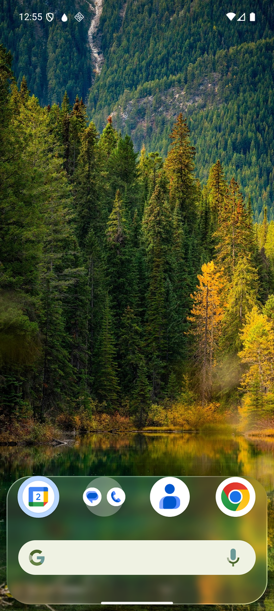
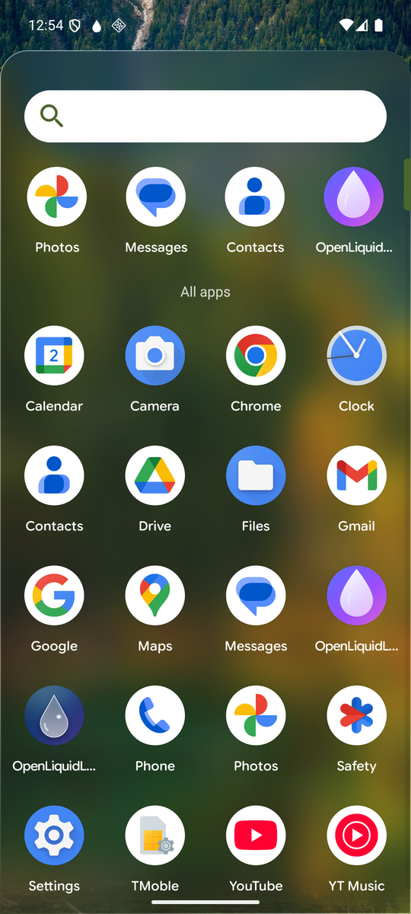
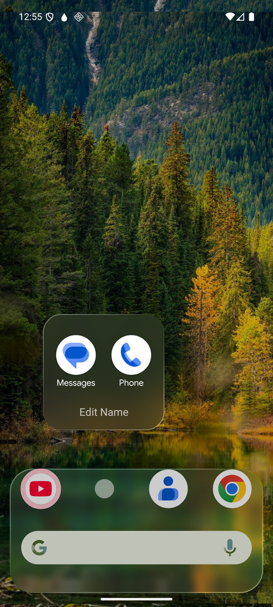
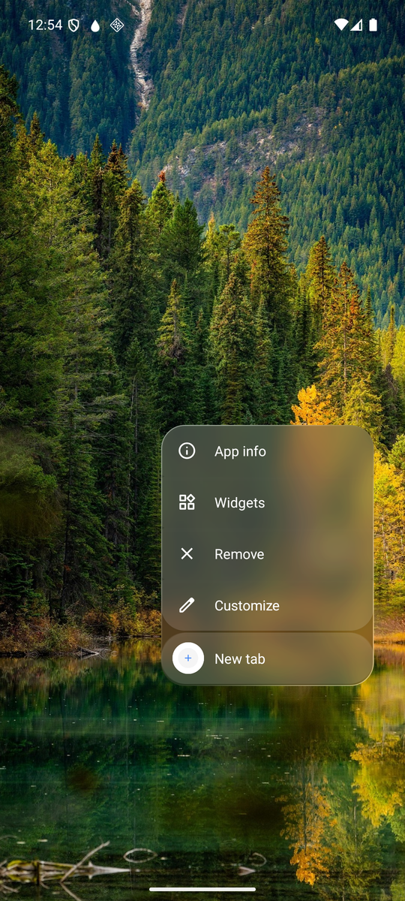
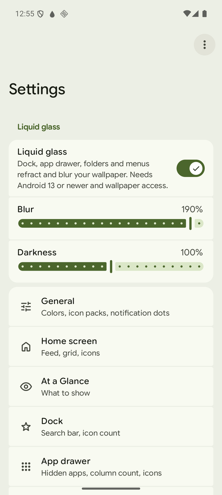

# OpenLiquidLauncher 2

An Android launcher where the dock, the app drawer, folders and menus are **liquid glass**: translucent layers that blur and refract your wallpaper, powered by [Kyant0/AndroidLiquidGlass](https://github.com/Kyant0/AndroidLiquidGlass).

It is a fork of [Lawnchair](https://github.com/LawnchairLauncher/lawnchair) (itself based on AOSP Launcher3), so it keeps a mature home screen engine: paged grid, drag & drop, folders, widgets, shortcuts, icon packs, gestures, themed icons, notification dots and the full Lawnchair settings.

> Personal, **non-commercial** project. Not affiliated with the Lawnchair team or Google.

| Home | Drawer | Folder |
|---|---|---|
|  |  |  |

| Long-press menu | Settings |
|---|---|
|  |  |

## What is glass

| Surface | Look |
|---|---|
| Dock | Floating capsule with blur, lens refraction and a light rim |
| App drawer | Full glass sheet with strong blur, light labels |
| Opened folder | Rounded glass panel |
| Long-press / options menus | Single glass panel, light icons and text |
| Closed folder icon, drawer search field | Frosted translucent disc / pill |

Everything else (home grid, icons, widgets, settings pages) is stock Lawnchair.

**Settings -> Liquid glass** lets you turn the effect off and tune blur and darkness.

## Requirements

- **Android 13 (API 33) or newer** for the glass shaders. Below that the launcher still works with the regular Lawnchair look (tested on Android 12).
- **Wallpaper access.** To refract your wallpaper, the launcher must be able to read it. Open *Settings -> Liquid glass -> Allow wallpaper access* and grant the files/media permissions. Without it, the launcher keeps the regular look.
- Live (animated) wallpapers cannot be read, so the glass is not drawn with them.

## Install

Download the signed APK from the [latest release](../../releases/latest) and install it. The package is `com.linuxkernel44.openliquidlauncher2`, so it installs next to Lawnchair or your current launcher. Then set it as the default home app.

Release signature (SHA-256 of the certificate):
`f1:4a:7c:af:69:03:c4:7a:64:d6:d5:ce:39:21:67:df:d9:15:b3:66:cc:8f:35:dc:36:f8:c1:8f:18:90:15:a2` (verify with `apksigner verify --print-certs`).

## Build

```
git clone --recurse-submodules https://github.com/LinuxKernel44/OpenLiquidLauncher-2.git
cd OpenLiquidLauncher-2
export ANDROID_HOME=$HOME/Android/Sdk JAVA_HOME=/usr/lib/jvm/java-21-openjdk
./gradlew assembleLawnWithQuickstepGithubDebug      # debug APK in build/outputs/apk
./gradlew assembleLawnWithQuickstepGithubRelease    # needs keystore.properties (see build.gradle)
```

Notes:
- After editing `PreferenceManager.kt`, do a clean build with `--no-build-cache`; an incremental build can crash at launch with `NoSuchFieldError: $stable`.
- Test the glass on an Android 13+ device or emulator.

## Credits and license

- [Lawnchair](https://github.com/LawnchairLauncher/lawnchair) and its contributors.
- [AOSP Launcher3](https://android.googlesource.com/platform/packages/apps/Launcher3/).
- [AndroidLiquidGlass](https://github.com/Kyant0/AndroidLiquidGlass) by Kyant0 (Apache-2.0).

Licensed under the Apache License 2.0, see [LICENSE.txt](LICENSE.txt) and [NOTICE](NOTICE).
